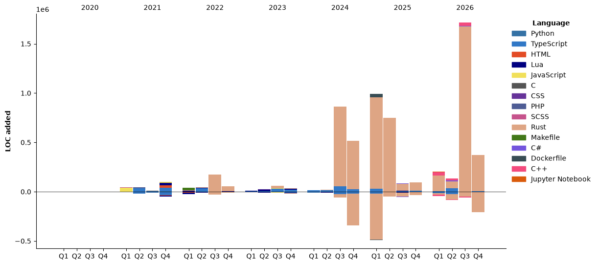

## Code time of the week (updated every 19:00 UTC)

<!--START_SECTION:waka-->


**🐱 My GitHub Data** 

> 📦 274.7 kB Used in GitHub's Storage 
 > 
> 🏆 1,397 Contributions in the Year 2026
 > 
> 🚫 Not Opted to Hire
 > 
> 📜 49 Public Repositories 
 > 
> 🔑 0 Private Repositories 
 > 
**I'm a Night 🦉** 

```text
🌞 Morning                858 commits         ██░░░░░░░░░░░░░░░░░░░░░░░   07.96 % 
🌆 Daytime                3302 commits        ████████░░░░░░░░░░░░░░░░░   30.62 % 
🌃 Evening                2837 commits        ███████░░░░░░░░░░░░░░░░░░   26.31 % 
🌙 Night                  3787 commits        █████████░░░░░░░░░░░░░░░░   35.12 % 
```
📅 **I'm Most Productive on Monday** 

```text
Monday                   1943 commits        █████░░░░░░░░░░░░░░░░░░░░   18.02 % 
Tuesday                  1601 commits        ████░░░░░░░░░░░░░░░░░░░░░   14.85 % 
Wednesday                1503 commits        ███░░░░░░░░░░░░░░░░░░░░░░   13.94 % 
Thursday                 1360 commits        ███░░░░░░░░░░░░░░░░░░░░░░   12.61 % 
Friday                   1543 commits        ████░░░░░░░░░░░░░░░░░░░░░   14.31 % 
Saturday                 1248 commits        ███░░░░░░░░░░░░░░░░░░░░░░   11.57 % 
Sunday                   1586 commits        ████░░░░░░░░░░░░░░░░░░░░░   14.71 % 
```


📊 **This Week I Spent My Time On** 

```text
🕑︎ Time Zone: Asia/Tokyo

💬 Programming Languages: 
Rust                     24 hrs 10 mins      ████████████████░░░░░░░░░   64.39 % 
C++                      3 hrs 40 mins       ██░░░░░░░░░░░░░░░░░░░░░░░   09.78 % 
Lua                      2 hrs 50 mins       ██░░░░░░░░░░░░░░░░░░░░░░░   07.56 % 
TOML                     1 hr 37 mins        █░░░░░░░░░░░░░░░░░░░░░░░░   04.32 % 
JSON                     55 mins             █░░░░░░░░░░░░░░░░░░░░░░░░   02.49 % 

🔥 Editors: 
VS Code                  29 hrs 35 mins      ████████████████████░░░░░   78.82 % 
Claude Code              7 hrs 41 mins       █████░░░░░░░░░░░░░░░░░░░░   20.49 % 
Zed                      15 mins             ░░░░░░░░░░░░░░░░░░░░░░░░░   00.68 % 

💻 Operating System: 
Windows                  37 hrs 31 mins      █████████████████████████   100.00 % 
```

🤖 **AI Coding This Week** 

```text
⏱ AI Coding Time: 22 hrs 30 mins (59.98%)

✍️ 36,939 lines written by AI, 1,097 lines written by hand (97.12% AI-written)

🔤 10,272,622 Input Tokens, 2,792,546 Output Tokens

💵 $350.90 Estimated AI Cost This Week

🧠 13 AI Sessions, 237 AI Prompts

Opus                     40,812 lines        █████████████████████████   100.00 % 

🔎 AI Coding Insights:
🤖 AI-Driven — 97.12% of written lines came from AI
📝 Concise Prompter — average 173 characters per prompt
🔁 Iterative Prompter — average 18 prompts per session
🚀 High AI Trust — 6.1% of changed lines were hand-edited
```

**Timeline**




 Last Updated on 24/11/2026 04:14:30 UTC
<!--END_SECTION:waka-->