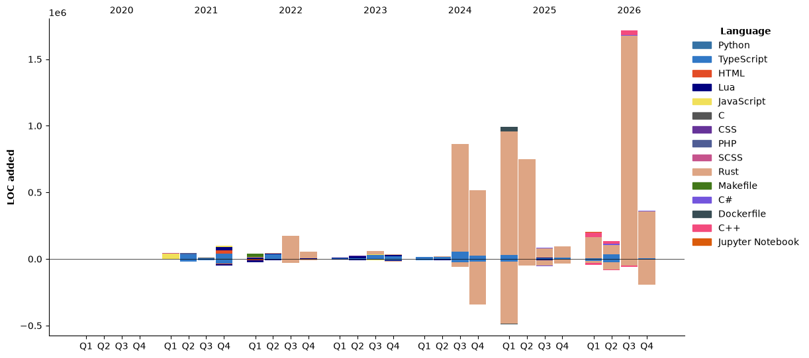

## Code time of the week (updated every 19:00 UTC)

<!--START_SECTION:waka-->


**🐱 My GitHub Data** 

> 📦 270.5 kB Used in GitHub's Storage 
 > 
> 🏆 1,120 Contributions in the Year 2026
 > 
> 🚫 Not Opted to Hire
 > 
> 📜 47 Public Repositories 
 > 
> 🔑 0 Private Repositories 
 > 
**I'm a Night 🦉** 

```text
🌞 Morning                856 commits         ██░░░░░░░░░░░░░░░░░░░░░░░   08.10 % 
🌆 Daytime                3243 commits        ████████░░░░░░░░░░░░░░░░░   30.68 % 
🌃 Evening                2757 commits        ███████░░░░░░░░░░░░░░░░░░   26.09 % 
🌙 Night                  3713 commits        █████████░░░░░░░░░░░░░░░░   35.13 % 
```
📅 **I'm Most Productive on Monday** 

```text
Monday                   1918 commits        █████░░░░░░░░░░░░░░░░░░░░   18.15 % 
Tuesday                  1598 commits        ████░░░░░░░░░░░░░░░░░░░░░   15.12 % 
Wednesday                1481 commits        ████░░░░░░░░░░░░░░░░░░░░░   14.01 % 
Thursday                 1327 commits        ███░░░░░░░░░░░░░░░░░░░░░░   12.56 % 
Friday                   1504 commits        ████░░░░░░░░░░░░░░░░░░░░░   14.23 % 
Saturday                 1185 commits        ███░░░░░░░░░░░░░░░░░░░░░░   11.21 % 
Sunday                   1556 commits        ████░░░░░░░░░░░░░░░░░░░░░   14.72 % 
```


📊 **This Week I Spent My Time On** 

```text
🕑︎ Time Zone: Asia/Tokyo

💬 Programming Languages: 
Rust                     26 hrs 47 mins      ████████████████░░░░░░░░░   63.86 % 
Praat                    4 hrs 17 mins       ███░░░░░░░░░░░░░░░░░░░░░░   10.22 % 
Python                   3 hrs 25 mins       ██░░░░░░░░░░░░░░░░░░░░░░░   08.17 % 
Markdown                 3 hrs 3 mins        ██░░░░░░░░░░░░░░░░░░░░░░░   07.29 % 
TOML                     2 hrs 9 mins        █░░░░░░░░░░░░░░░░░░░░░░░░   05.16 % 

🔥 Editors: 
VS Code                  35 hrs 24 mins      █████████████████████░░░░   84.38 % 
Claude Code              6 hrs 33 mins       ████░░░░░░░░░░░░░░░░░░░░░   15.62 % 

💻 Operating System: 
Windows                  41 hrs 57 mins      █████████████████████████   100.00 % 
```

🤖 **AI Coding This Week** 

```text
⏱ AI Coding Time: 21 hrs 51 mins (52.1%)

✍️ 55,832 lines written by AI, 7,256 lines written by hand (88.5% AI-written)

🔤 12,267,807 Input Tokens, 3,450,018 Output Tokens

💵 $286.17 Estimated AI Cost This Week

🧠 7 AI Sessions, 190 AI Prompts

Opus                     57,377 lines        █████████████████████████   100.00 % 

🔎 AI Coding Insights:
🤖 AI-Driven — 88.5% of written lines came from AI
📄 Detailed Prompter — average 623 characters per prompt
🔁 Iterative Prompter — average 27 prompts per session
🚀 High AI Trust — 13.78% of changed lines were hand-edited
```

**Timeline**




 Last Updated on 10/11/2026 23:58:39 UTC
<!--END_SECTION:waka-->